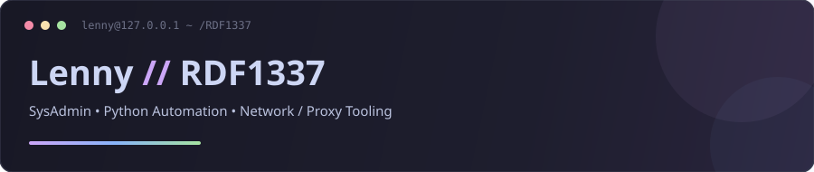

 

---

### `~/stack`

### `~/projects`

| Проект | Стек | Описание |
| :--- | :---: | :--- |
| **[FFmpegGUI](https://github.com/RDF1337/FFmpegGUI)** | `Python` | Современный GUI для быстрой конвертации, сжатия и обрезки видео/аудио через FFmpeg |
| **[har2mp4GUI](https://github.com/RDF1337/har2mp4GUI)** | `Python` | Автоматическое извлечение медиасегментов из `.har` и сборка в готовый `.mp4` |
| **[discord-quest-completer](https://github.com/RDF1337/discord-quest-completer)** | `Python` | Легковесная Windows CLI-утилита для выполнения Discord Quests без скачивания игр и инъекций |
| **[yaml-generator](https://github.com/rknbypass/yaml-generator)** | `JS` | Веб-генератор готовых YAML-конфигов из ссылок VLESS / Hysteria 2 для прокси-клиентов |
| **[DiscordSnippets](https://github.com/RDF1337/DiscordSnippets)** | `CSS` | Кастомные CSS-сниппеты для Vencord |
